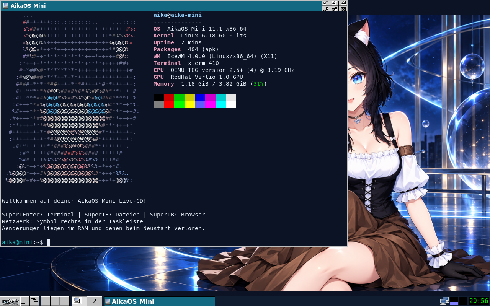

# AikaOS Mini 💿

**AikaOS on a 700 MB CD — with the Aika desktop and Firefox ESR.**

CD Edition 11.1 is a lightweight live system for x86_64 PCs. It uses Alpine Linux 3.24 and IceWM to fit on a CD while keeping the Aika look and essential desktop features.

**[AikaOS full version →](https://github.com/emiliaplays/AikaOS)** — looking for the regular AikaOS edition? Visit the main project.



## Download

**[Download the ISO and extras](https://github.com/emiliaplays/AikaOS-mini/releases/tag/v11.1-cd)**

| Detail | Value |
| --- | --- |
| ISO | `aikaos-mini-11.1-cd-x86_64.iso` |
| Size | **684,285,952 bytes / 684.3 MB** |
| CD size limit | 700,000,000 bytes |
| Architecture | x86_64, BIOS and UEFI |
| Memory | 4 GB recommended and tested in QEMU |
| Desktop / Browser | IceWM / Firefox ESR |

SHA-256:

```text
2543c5b506a70abf17657a314b39be8cd1bce069c2ba76baf2e2f3beb3392baf
```

The release includes the ISO, its checksum, build sources, documentation and a printable CD sleeve.

## Burn and boot

1. Download the ISO. In PowerShell, check its checksum with `Get-FileHash .\aikaos-mini-11.1-cd-x86_64.iso -Algorithm SHA256`.
2. Choose **Burn ISO / disc image** in your burning software. Use a 700 MB CD-R, finalize the disc and verify it after burning. A compatible blank labeled “Audio CD-R” is written as a bootable data image here.
3. Select the CD/DVD drive in your PC's boot menu. Secure Boot must be disabled for this edition.
4. The Aika desktop starts automatically. The initial boot from a physical CD may take a while.

## What's included

- Aika wallpaper, start menu, logo and Fastfetch portrait
- Firefox ESR with HTML5 video; YouTube requires internet access
- PCManFM, Mousepad and a terminal
- Network/Wi-Fi applet and volume controls
- German keyboard layout and Europe/Berlin time zone
- Shortcuts: **Super+Enter** terminal, **Super+E** files, **Super+B** browser

This is an experimental **live CD without an installer or persistent storage**. Changes are kept in RAM and lost on reboot. Save files you want to keep to another drive. The live user `aika` logs in automatically and can use `sudo` without a password. The package manager is `apk`.

## Paper CD sleeve

[Black-and-white folding sleeve with Aika in the circle (PDF)](print/AikaOS-CD-Falthuelle-A4-Schwarzweiss-Aika.pdf): print single-sided on A4 at **100% / actual size**. Cut out the outline, fold along the dashed lines and glue the side tabs to the outside. The finished pocket measures approximately 126 × 126 mm. A 50 mm calibration line helps you check the print scale. The PDF instructions are in German.

## Testing and limitations

The final ISO was booted in QEMU with 4 GB RAM under both BIOS and UEFI from a read-only virtual CD drive. Checks covered the desktop, networking, HTTPS and the modloop signature. The YouTube test demonstrated video playback and an active Firefox audio stream. It took place before the final OpenSSL addition; the existing browser and desktop packages were then compared byte for byte with the final ISO.

See [ABNAHME.txt](verification/ABNAHME.txt) for the detailed test report in German. The technical checks do not cover physical hardware or guarantee a particular video resolution. The maintainer additionally reports successful operation from a 700 MB CD.

## Sources and building

This repository contains the CD configuration, build and test scripts, the prepared configuration overlay, assets and verification reports. The ISO is available in the GitHub release.

[BUILD-HINWEISE.txt](BUILD-HINWEISE.txt) documents the original build in German. The scripts describe a prepared local build environment; they are **not a ready-to-use, one-command builder**. Some steps depend on local reference directories and host tools, so the prepared overlay is included under `prepared/`. Newer Alpine packages may change the image size and checksum.

The [package list](verification/cd-packages.txt) and [manifest](verification/cd-build-manifest.json) describe this specific ISO. Project software is licensed under GPL-3.0-or-later; third-party components retain their respective licenses. See [LICENSE](LICENSE), [THIRD_PARTY.md](THIRD_PARTY.md) and [ARTWORK.md](ARTWORK.md).
